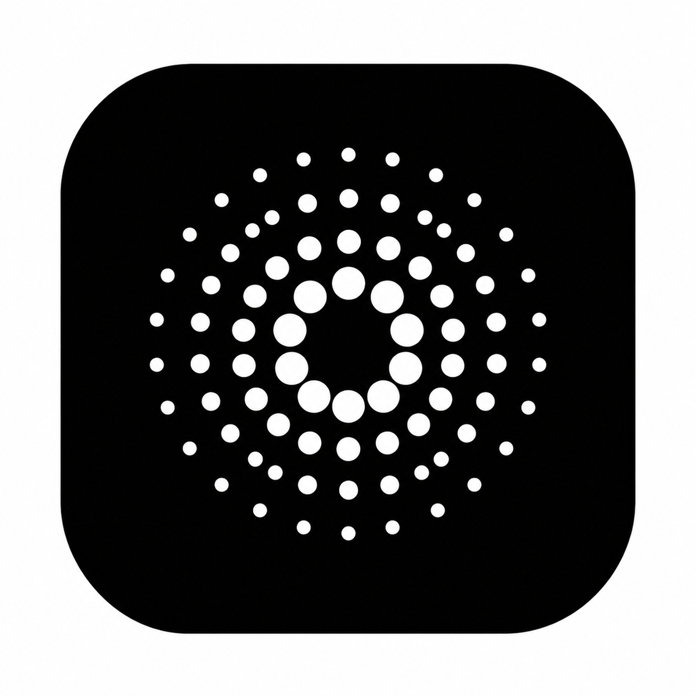
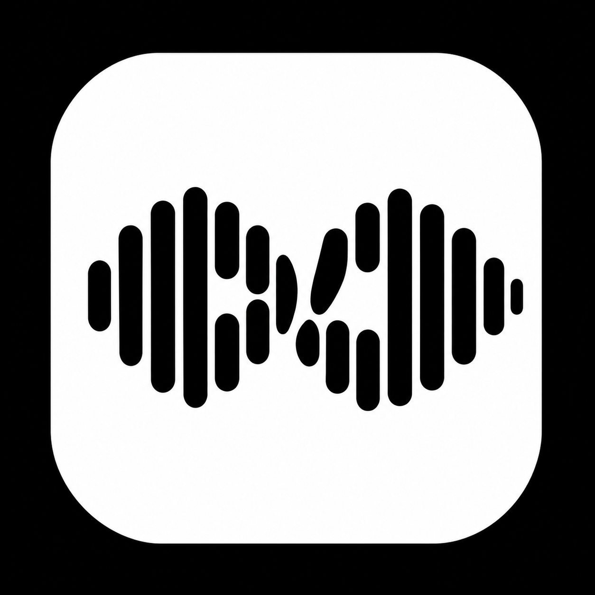
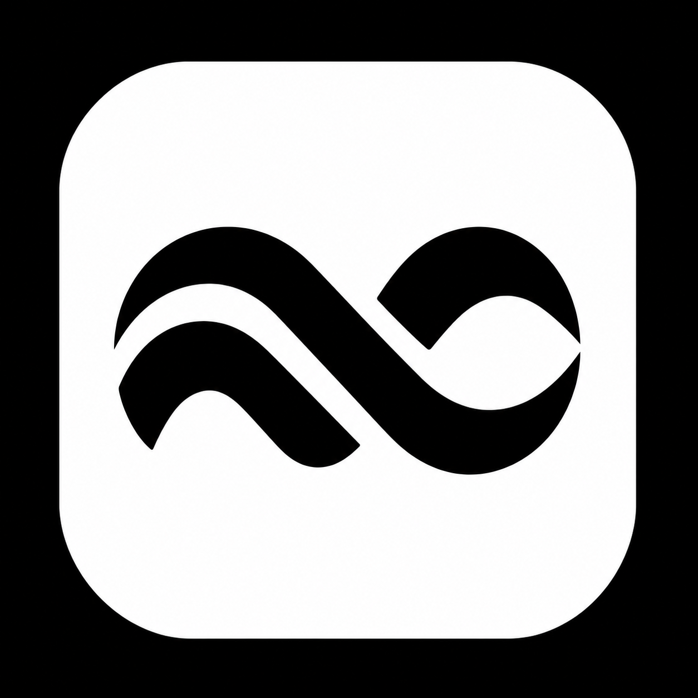
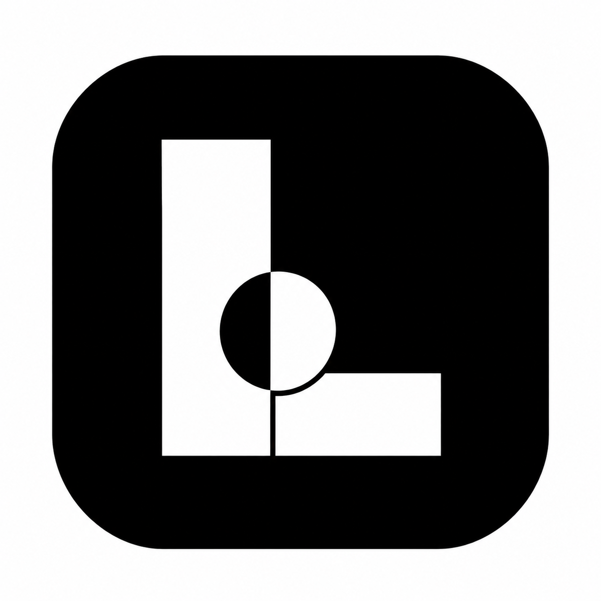
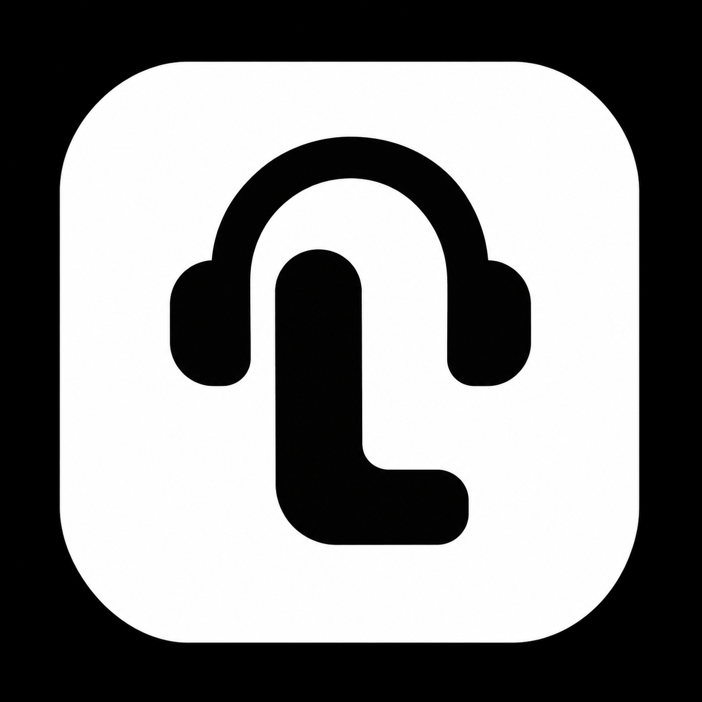
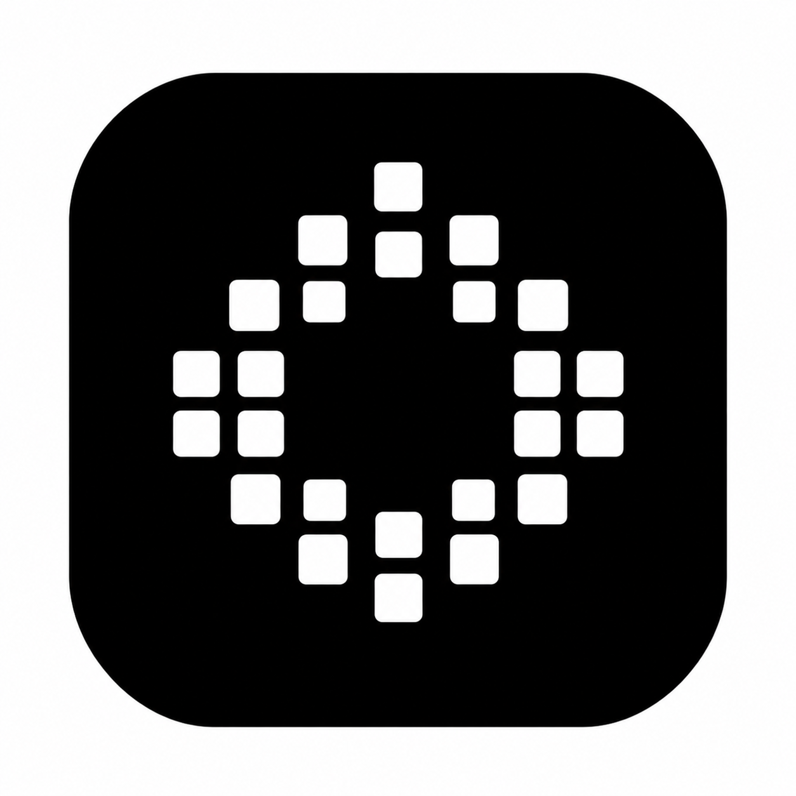

# Loopd 🎵

<div align="center">



### The Pure, High-Fidelity Music Experience

**Loopd** is an ultra-fast, modern music streaming and discovery application engineered with high-fidelity lossless audio, real-time synchronized lyrics, intelligent ambient sound recognition, dynamic theme engines, and tailored icon personalization.

[](#supported-platforms)
[](#-high-fidelity-lossless-audio-engine)
[](#-modern-ui--experience)
[](#-license)

</div>

---

## 🎨 Bespoke App Personalization & Custom Icons

Loopd offers **6 distinct handcrafted launcher icons**, each celebrating a unique acoustic and geometric visual identity. Users can switch between these styles dynamically inside **Settings → Appearance → App Icon**, complete with personalized launch transitions and splash animations.

<div align="center">

| <br>**LooPd**<br>*(Signature)* | <br>**PULSE**<br>*(Waveform)* | <br>**FLOW**<br>*(Stream)* |
| :---: | :---: | :---: |
| Concentric acoustic ripples radiating outward from the core frequency | Dynamic audio frequency waveform bar spectrum | Continuous melodic loop stream with harmonic fluid curves |
| <br>**AXIS**<br>*(Geometric)* | <br>**TUNE**<br>*(Acoustic)* | <br>**ORBIT**<br>*(Satellite)* |
| Precision geometric alignment cross-rotor matrix | Headphone acoustic resonance curve and tonal contour | Constellation satellite synchronization matrix |

</div>

- **Dynamic Splash Reveals**: Each icon choice triggers a matching splash reveal animation during launch, echoing the icon's signature geometry from the Android system launcher straight into the player.
- **System Adaptive Shapes**: Full support for Android 13+ themed monochromatic icons, circle squircle masks, and edge-to-edge system palettes.

---

## ✨ Features & Highlights

### 🎧 High-Fidelity Lossless Audio Engine
- **Pure Sound Quality**: Stream and download high-resolution audio (FLAC up to 24-bit / 44.1 kHz & 96 kHz) with crystal-clear acoustic clarity.
- **Adaptive Bitrate Streaming**: Smooth playback with intelligent pre-buffering that adapts dynamically to network conditions without stuttering.
- **Integrated AutoEq Profiles**: Parametric equalization corrections tailored for hundreds of headphone and IEM models for studio-grade acoustic balance.
- **Gapless Playback & Normalization**: Continuous transitions between album tracks with ReplayGain loudness normalization.

### 🎙️ "What's this song?" Sound Recognition
- **Instant Ambient Audio Search**: Discover music playing in the room with a single tap from the search bar.
- **Live Sound-Wave Orb**: An organic visualizer disc that pulses dynamically in sync with ambient microphone frequencies during listening.
- **One-Tap Play & Library Save**: Immediately play identified tracks, inspect album metadata, or bookmark them directly to playlists.

### 📜 Real-Time Synced Lyrics
- **Line-by-Line Synchronized Scrolling**: Interactive time-stamped lyrics that automatically track the current playback position.
- **Multi-Source Aggregation**: Real-time lyric fetching powered by LRCLIB, KuGou, and community lyric backends to ensure comprehensive song coverage.
- **Distraction-Free Typography**: High-contrast, scalable typography designed for effortless reading in dark or light environments.

### 📚 Comprehensive Library & Offline Experience
- **Offline Download Manager**: Download favorite albums, playlists, and tracks with embedded HD artwork and metadata for offline listening anytime.
- **Personalized Listening Stats**: View total minutes listened, play counts, and top artist trends with personalized listening history cards.
- **Smart Song Organization**: Filter tracks by artist, album, local downloads, liked tracks, and custom user playlists.
- **Unified Local Audio Playback**: Scan and play on-device audio files alongside streaming tracks in a seamless unified queue.

### 🌌 Modern UI & Experience
- **Material 3 & Jetpack Compose**: Built natively using the latest declarative Android UI framework with responsive glassmorphic cards and fluid spring animations.
- **System Media Notification**: AndroidX Media3 player notification controls with dynamic artwork color palettes, playback seek bars, and quick actions.
- **Sleep Timer**: Fall asleep to your favorite soothing playlists with gradual volume fade-out.
- **Radio & Recommendations**: Discover endless continuous radio streams inspired by your current favorite track or artist.

---

## 📱 Supported Platforms

- **Android Phones & Tablets**:
  - Android 8.0 (Oreo, API 26) through Android 15+.
  - Fully optimized for ARM64-v8a, armeabi-v7a, and x86_64 architectures.
  - Edge-to-edge immersive UI, gesture navigation, and dynamic system color theming.
- **Wear OS**:
  - Standalone smartwatch playback and companion playback controls for your wrist.

---

## 🛠️ Building & Developing

### Prerequisites
- Android Studio Ladybug (or newer)
- JDK 17 (Microsoft OpenJDK 17 or Temurin 17 recommended)
- Android SDK 35+

### Build the Android APK
```bash
# Debug build
./gradlew :app:assembleDebug

# Release build
./gradlew :app:assembleRelease

# Install directly to connected device or emulator
./gradlew :app:installDebug
```

---

## 🔒 Privacy & Freedom

- **No Ads & No Tracking**: Loopd respects your privacy and contains zero advertising SDKs, tracker beacons, or telemetry brokers.
- **Open Standard**: Full transparency, respecting user freedom, battery efficiency, and device storage.

---

## 📄 License

This project is licensed under the [GNU General Public License v3.0](LICENSE).
