# Loopd 🎵

### The Pure, High-Fidelity Music Experience

**Loopd** is an ultra-fast, modern music streaming and discovery application engineered with high-fidelity lossless audio, real-time synchronized lyrics, intelligent sound recognition, and dynamic UI personalization.

---

## ✨ Features & Highlights

### 🎧 High-Fidelity Lossless Audio Engine
- **Pure Sound Quality**: Stream and download high-resolution audio (FLAC up to 24-bit / 44.1 kHz & 96 kHz) with crystal-clear acoustic clarity.
- **Adaptive Bitrate Streaming**: Smooth, seamless playback with intelligent buffering that adapts to network conditions without stuttering.
- **Integrated AutoEq Profiles**: Built-in parametric equalization corrections tailored for hundreds of headphone and IEM models for studio-grade acoustic balance.
- **Gapless Playback & Normalization**: Continuous cross-track transitions with replay gain loudness normalization.

### 🎙️ "What's this song?" Sound Recognition
- **Instant Ambient Audio Search**: Discover music playing around you in seconds with a single tap.
- **Live Sound-Wave Orb**: An organic visualizer disc that animates and beats dynamically in sync with ambient audio frequencies.
- **One-Tap Play & Library Save**: Immediately stream discovered songs or save them straight to your playlists and library.

### 📜 Real-Time Synced Lyrics
- **Line-by-Line Synchronized Scrolling**: Interactive time-stamped lyrics that automatically track the current playback position.
- **Multi-Source Fallback**: Aggregated lyric streaming powered by LRCLIB, Kugou, and community providers to ensure near-universal track coverage.
- **Sing-Along Typography**: Elegant, high-legibility typography designed for distraction-free reading day or night.

### 🎨 Bespoke App Personalization & Custom Icons
- **6 Handcrafted Brand Marks**: Personalize your home screen and in-app brand identity with tailored icon editions:
  - **LooPd** — Concentric acoustic ripples radiating from the core (Default).
  - **PULSE** — Dynamic audio frequency waveform bar spectrum.
  - **FLOW** — Smooth, continuous melodic loop stream.
  - **AXIS** — Precision geometric alignment cross-rotor.
  - **TUNE** — Acoustic headphone resonance curve.
  - **ORBIT** — Constellation satellite synchronization matrix.
- **Seamless System Splash Transition**: Bespoke opening reveal animations designed specifically for each icon's geometry, transitioning smoothly from the Android system splash into the application.

### 📚 Comprehensive Library & Offline Experience
- **Offline Download Manager**: Cache your favorite albums, playlists, and tracks with embedded cover art and metadata for offline listening anytime, anywhere.
- **Personalized Listening Stats**: Track your total minutes listened, play counts, and top artist trends with personalized experience cards.
- **Smart Song Organization**: Filter songs by artist, album, local downloads, liked tracks, and custom playlists.
- **Local Media Playback**: Seamlessly scan and play your on-device audio files alongside streaming tracks in a unified queue.

### 🌌 Modern UI & System Integration
- **Material 3 & Jetpack Compose**: Built natively using the latest declarative Android UI framework with fluid animations and responsive glassmorphic cards.
- **Lock Screen & Media Notification**: Comprehensive AndroidX Media3 player notification controls with dynamic artwork palettes and playback seek bars.
- **Sleep Timer**: Fall asleep to your favorite soothing playlists with gradual volume fade-out.
- **Radio & Smart Recommendations**: Discover endless continuous radio stations inspired by your current favorite track or artist.

---

## 📱 Supported Platforms

- **Android**: Modern Android devices running Android 8.0 (Oreo, API 26) through Android 15+.
  - Optimized for ARM64-v8a, armeabi-v7a, and x86_64 architectures.
- **Desktop**: Compose Multiplatform desktop application for high-resolution desktop listening.

---

## 🔒 Privacy & Freedom

- **No Ads & No Tracking**: Loopd respects your privacy and contains no tracking SDKs, ad networks, or data-broker trackers.
- **Open Standard**: Complete transparency, respecting user freedom and device resources.

---

## 📄 License

This project is licensed under the [GNU General Public License v3.0](LICENSE).
